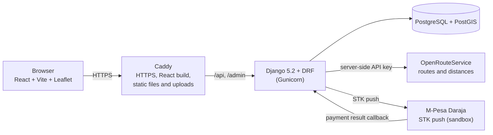

# FundisConnect

FundisConnect connects people who need home repair and renovation work with nearby artisans ("fundis" in Swahili). A customer picks a trade, marks where the job is, and sees artisans ranked by **driving distance**. They send a job request, with a photo or video if they like, to the artisan they choose. The artisan pays a small fee through **M-Pesa** to unlock the customer's contact details: a **pay-per-lead** model.

It was built in 2023 as a solo full-stack project and revisited in 2026 with a security review, a dependency modernisation and a test suite. See [Project history](#project-history).

## Demo

- **Original 2023 demo video:** [watch on Google Drive](https://drive.google.com/file/d/1OmUZMUxaKO92eCw6yLip8KehdFaUUqRu/view)
- **Live site:** not deployed at the moment. The production setup (Gunicorn, systemd, Caddy) is ready in [`deploy/`](deploy/).
- **Run it yourself:** follow [Run it locally](#run-it-locally). One command, `seed_demo`, fills it with demo artisans and customers.

## How it works

**Customer**
1. Signs up, chooses a trade (plumber, electrician, carpenter, mason, tiling or painter) and marks the job location on a map.
2. Sees the matching artisans, nearest first, ranked by driving distance from OpenRouteService.
3. Sends a job request with a title, description, date, address and an optional photo or video.

**Artisan**
1. Signs up and creates a profile with a trade, a picture and a base location.
2. Sees the requests addressed to them, with the driving route to the job on a map.
3. Pays through M-Pesa (STK push) to unlock the customer's phone number and email. This is the pay-per-lead step.

**Admin** manages users, profiles, requests and payments in the Django admin at `/admin/`.

## Architecture



In development, the Vite dev server plays Caddy's role and forwards `/api`, `/admin` and `/media` to Django, so the browser always talks to a single address.

## Tech stack

| Layer | Technology |
|---|---|
| Frontend | React 18, Vite 4, React Router, Leaflet, Bootstrap, PrimeReact |
| Backend | Python 3.14, Django 5.2 LTS, Django REST Framework, DRF-GIS (GeoJSON), Jazzmin admin |
| Database | PostgreSQL 18 with PostGIS 3.6 (GeoDjango) |
| Routing | OpenRouteService: directions and distance matrix, called from the server only |
| Payments | M-Pesa Daraja STK push (sandbox) |
| Production | Gunicorn, systemd, Caddy with automatic HTTPS |
| Tests | Django test runner, 60 tests |

## Project layout

```
FundisConnect-FullStack/
├── FundisConnect/            Django project (manage.py lives here)
│   ├── FundisConnect/        settings, URLs, shared upload validators
│   ├── user_api/             accounts, login, roles, password reset, seed_demo command
│   ├── artisans_api/         artisan profiles (GeoJSON locations, pictures)
│   ├── customers_api/        job requests and customer contact details
│   ├── payment_api/          M-Pesa payments
│   └── routing_api/          server-side OpenRouteService access
├── React-app/FundisConnect/  React single-page app
├── deploy/                   Gunicorn, systemd and Caddy configuration
└── requirements.txt          Python dependencies
```

## Run it locally

### 1. Windows: install WSL first

The project runs on Linux. On Windows 10 or 11, use WSL2 with Ubuntu:

1. Open **PowerShell as administrator** and run `wsl --install -d Ubuntu`. Restart if asked.
2. Open **Ubuntu** from the Start menu and create a Linux username and password.
3. Do everything below **inside that Ubuntu terminal**. Keep the project in your Linux home folder (`~/projects`), not under `/mnt/c`: file access across that boundary is slow and can break file watching.
4. Open the app later in your normal Windows browser. WSL forwards the ports.

Linux users start at step 2. macOS is untested; the same steps should work with Homebrew packages for PostgreSQL, PostGIS and GDAL.

Tested on Ubuntu 26.04 LTS under WSL2 with Python 3.14, PostgreSQL 18, PostGIS 3.6 and Node 24.

### 2. System packages

```bash
sudo apt update
sudo apt install -y git build-essential python3-venv python3-dev libpq-dev \
  gdal-bin libgdal-dev postgresql postgis
```

Node.js 18 or newer, through nvm:

```bash
curl -o- https://raw.githubusercontent.com/nvm-sh/nvm/v0.40.0/install.sh | bash
# close and reopen the terminal, then:
nvm install --lts
```

Python 3.12 or newer is recommended. If your Ubuntu ships an older one, install a newer Python with [uv](https://docs.astral.sh/uv/).

### 3. Database

```bash
sudo -u postgres psql
```

then, inside `psql`:

```sql
CREATE ROLE fundis_app WITH LOGIN CREATEDB;
\password fundis_app
CREATE DATABASE fundisconnect OWNER fundis_app;
\c fundisconnect
CREATE EXTENSION postgis;
\c template1
CREATE EXTENSION IF NOT EXISTS postgis;
\q
```

`\password` asks you to choose the app's database password. `CREATEDB` and PostGIS in `template1` let the test runner create its throwaway database.

### 4. Backend

```bash
mkdir -p ~/projects && cd ~/projects
git clone https://github.com/mkiki254/FundisConnect-FullStack.git
cd FundisConnect-FullStack

python3 -m venv .venv
source .venv/bin/activate
pip install -r requirements.txt

cd FundisConnect
cp .env.example .env
```

Open `.env` and set:

| Variable | What to put |
|---|---|
| `DJANGO_SECRET_KEY` | the output of `python -c "import secrets; print(secrets.token_urlsafe(50))"` |
| `DB_PASSWORD` | the password you chose in step 3 |
| `ORS_API_KEY` | a free key from [openrouteservice.org](https://openrouteservice.org), needed for distances and routes |

Leave the email and M-Pesa lines empty unless you want those features. Every variable must exist, so don't delete the empty ones. `.env` is ignored by Git. Then:

```bash
python manage.py migrate
python manage.py createsuperuser
python manage.py seed_demo --password 'choose-a-demo-password'
python manage.py runserver
```

`createsuperuser` asks for an email, a username, a user type (enter `admin`), a 10-digit phone number and a password. The password is shown as you type, a quirk of the custom user model. `seed_demo` creates the demo accounts described below.

### 5. Frontend

In a second terminal:

```bash
cd ~/projects/FundisConnect-FullStack/React-app/FundisConnect
npm install
npm run dev
```

Open **http://127.0.0.1:3000** (use that address, not `localhost`).

### 6. Try it

| Role | Accounts | Password |
|---|---|---|
| Customers | `demo.customer1@example.com`, `demo.customer2@example.com` | the one you gave `seed_demo` |
| Artisans | `demo.artisan1@example.com` to `demo.artisan8@example.com` | the same |

- As **customer 1**, make a job request: choose a trade, mark a location in Nairobi, and click Find Artisans. The matching artisans appear nearest first.
- As **artisan 1**, you have two requests. The one from customer 1 is already paid, so the customer's contact details are visible. Customer 2's request to the same artisan stays locked: that's the pay-per-lead rule.
- Open `/admin/` with your superuser account for the admin site.

Real M-Pesa payments need Daraja sandbox credentials and a public HTTPS callback address, so they won't complete on a laptop. The demo data includes one pre-paid lead for that reason.

## Run the tests

```bash
cd ~/projects/FundisConnect-FullStack/FundisConnect   # next to manage.py, venv active
python manage.py test
```

60 tests run against a throwaway PostGIS database. They never call OpenRouteService, which is replaced by a stand-in. The `CREATEDB` role and `template1` setup from step 3 are required.

## Configuration reference

| Variable | Required | Purpose |
|---|---|---|
| `DJANGO_SECRET_KEY` | yes | signs sessions and tokens |
| `DJANGO_DEBUG` | yes | `True` locally, `False` in production |
| `DJANGO_ALLOWED_HOSTS` | yes | comma-separated hostnames |
| `DB_NAME`, `DB_USER`, `DB_PASSWORD` | yes | PostGIS database |
| `CORS_ALLOWED_ORIGINS`, `CSRF_TRUSTED_ORIGINS`, `FRONTEND_URL` | yes | where the frontend is served from |
| `EMAIL_HOST`, `EMAIL_HOST_USER`, `EMAIL_HOST_PASSWORD` | yes (may be empty) | password-reset email |
| `MPESA_*`, `MPESA_CALLBACK_URL` | yes (may be empty) | Daraja sandbox credentials and callback address |
| `ORS_API_KEY` | yes | OpenRouteService key, used only by the server |
| `DB_HOST`, `DB_PORT`, `EMAIL_PORT`, `EMAIL_USE_TLS`, `EMAIL_BACKEND`, `MPESA_ENVIRONMENT` | no | defaults: `127.0.0.1`, `5432`, `587`, `True`, SMTP backend, `sandbox` |
| `DJANGO_HTTPS` | no | secure cookies, HTTPS redirect and HSTS. On by default when `DJANGO_DEBUG` is `False` |
| `TRUSTED_PROXIES` | no | number of proxies in front of Django (default `0`, set `1` behind Caddy) |

## Security review

In 2026 I audited my own 2023 code by reproducing problems with two accounts and Postman, then fixed each one **test-first**: the test failed against the old code before the change.

| Problem found | Fix |
|---|---|
| Register and login responses echoed the plaintext password | password fields are write-only |
| Missing fields returned 500 errors | clean 400 responses |
| Anyone could register as `admin` | only customer and artisan can self-register |
| Any logged-in user could read, edit or delete any job request | queries are scoped to the owner, or to the artisan the request is addressed to; others get 404 |
| Any logged-in user could list every customer's phone and email, which bypassed pay-per-lead | an artisan sees only customers whose lead they paid for |
| Payment records, with phone numbers, were listed to anonymous visitors | artisans see only their own payments |
| Customers could create artisan profiles and artisans could create job requests; a second profile crashed | role checks and clean errors |
| Uploads had no size or type limit | photos up to 10 MB, videos up to 50 MB, allowed types only |
| No rate limit on login, register and password reset, and the limit could be dodged with a forged `X-Forwarded-For` header | 10 requests a minute, proxy-aware |
| The OpenRouteService key shipped in the browser bundle | routing moved behind `/api/route/` and `/api/route/distances/` |
| Credentials were committed to the repository | rotated, configuration moved to environment variables |
| HTML "browsable API" page and permissive framing | JSON-only responses, framing denied |

## Known limitations

- **Payments are sandbox-only.** The M-Pesa callback endpoint does not verify who is calling, so a forged "success" message could unlock a lead. The flow keeps its state in process memory, so production runs a single Gunicorn worker. The amount is a test value, and `django-daraja` has not been maintained since 2023. Fixing this means storing each STK push in the database, matching the callback by `CheckoutRequestID`, and replacing the library.
- **Password reset:** tokens do not expire, and the endpoint reveals whether an email is registered.
- Logout is a `GET` request.
- Deleting an artisan profile deletes the job requests addressed to that artisan.
- No pagination on list endpoints. A search considers at most 50 artisans.
- `createsuperuser` shows the password as you type it.
- **Frontend:** no automated tests, a large JavaScript bundle (about 1.1 MB before compression), no default avatar, upload validation errors are not shown in the profile form, and `npm audit` reports findings in the 2023 dependency set.

## Deployment

Not live yet. The configuration is ready in [`deploy/`](deploy/): Gunicorn (one worker with threads, listening on localhost only), a systemd unit, and a Caddyfile that serves the React build, static files and uploads, and sends only `/api` and `/admin` to Django. To deploy on an Ubuntu LTS VPS:

1. Install the system packages and the database (steps 2 and 3 above).
2. Create a `fundis` user, clone the repository to `/srv/fundisconnect/app` and create a virtual environment in `/srv/fundisconnect/venv`.
3. Write a production `.env`: `DJANGO_DEBUG=False`, `TRUSTED_PROXIES=1`, your domain in the host and origin lists, and `MPESA_CALLBACK_URL=https://<domain>/api/payment/results/`.
4. Run `migrate` and `collectstatic`, then build the frontend with `npm run build`.
5. Install the systemd unit, install Caddy with `deploy/Caddyfile`, and set `SITE_ADDRESS` to your domain.

`DJANGO_DEBUG=False python manage.py check --deploy` reports no issues (one check is silenced on purpose, with the reason in `settings.py`).

## Project history

- **2023:** built over about four months as a solo project: Django REST API, React frontend, PostGIS locations, OpenRouteService routing and M-Pesa payments.
- **2026:** security review and fixes (above), Python 3.14 and Django 5.2 LTS, PostgreSQL 18, psycopg 3, configuration through environment variables, server-side routing, deployment configuration, a demo-data command, and a test suite that grew from none to 60 tests.

## What I would do next

1. Rework payments: database-backed STK attempts, verified callbacks, and a maintained client in place of `django-daraja`.
2. Deploy to a VPS and add a CI workflow that runs the tests on every push.
3. Frontend tests, mobile polish, a default avatar and visible upload errors.
4. Harden password reset, add pagination, and update the frontend dependencies.